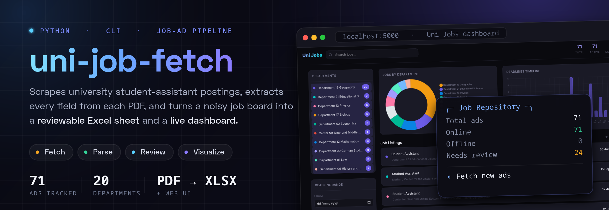
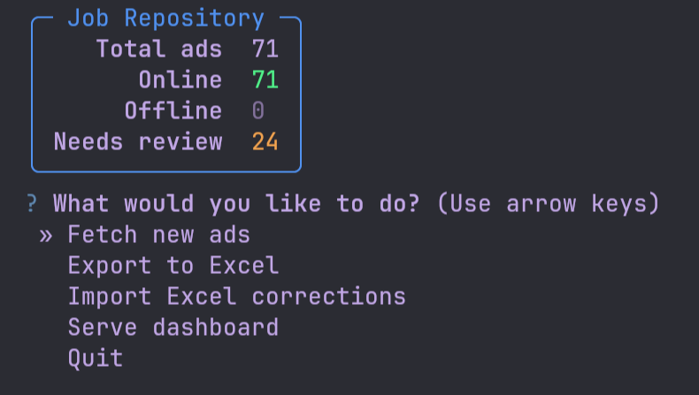
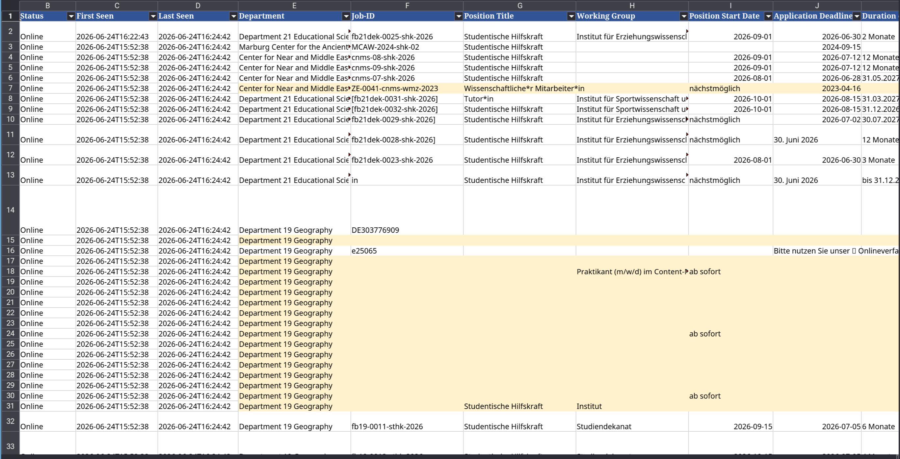
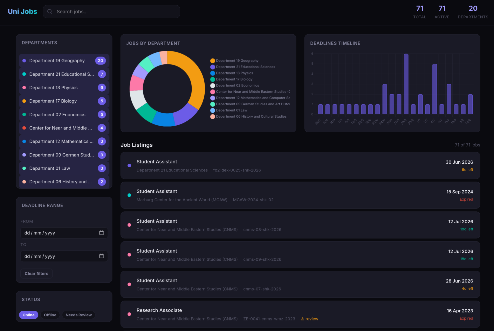

<p align="center">
  
</p>

<h1 align="center">uni-job-fetch</h1>

<p align="center">
  <em>Scrape university student-assistant job ads, extract every field, and turn a noisy job board into a reviewable Excel sheet and a live dashboard.</em>
</p>

<p align="center">
  
  
  
  
</p>

---

## What it does

University job boards publish openings as a sprawl of PDF flyers with different layouts, departments, and formats. **uni-job-fetch** turns that mess into clean, structured, trackable data:

- 🔎 **Fetch**: pulls new job-ad PDFs from the source and detects what's online, offline, or newly added.
- 🧩 **Parse**: extracts structured fields from each ad: department, position, working group, deadlines, pay, workload, contacts, and more.
- ✅ **Review**: round-trips through Excel so a human can correct anything the parser flagged as uncertain.
- 📊 **Visualize**: serves a dark, filterable dashboard with per-department breakdowns and a deadline timeline.

Everything runs from one interactive command-line menu.

---

## The CLI

A single entry point opens an interactive menu backed by a local job repository. It tracks how many ads are online, offline, and still **need review**.

<p align="center">
  
</p>

| Action | What it does |
| --- | --- |
| **Fetch new ads** | Scrapes the source, downloads new PDFs, and updates each ad's online/offline status. |
| **Export to Excel** | Writes the full repository to a spreadsheet for human review. |
| **Import Excel corrections** | Reads your edits back in and clears the *needs-review* flags. |
| **Serve dashboard** | Boots the web dashboard locally. |
| **Quit** | Exits. |

---

## Excel export &amp; corrections

Every ad is flattened into one row with all extracted fields. Rows the parser isn't sure about are marked **Needs Review** so you can fix pay, contacts, or deadlines by hand, then import the file back.

<p align="center">
  
</p>

Captured columns include:

> `Status` · `First Seen` · `Last Seen` · `Department` · `Job-ID` · `Position Title` · `Working Group` · `Position Start Date` · `Application Deadline` · `Duration of Contract` · `Pay` · `Workload` · `Contact Name` · `Emails` · `Phones` · `Needs Review` · `Original PDF Name` · `PDF link` 

---

## Dashboard

Run **Serve dashboard** to explore the repository in the browser: totals at a glance, a **Jobs by Department** donut, a **Deadlines Timeline**, and a filterable job list with live countdowns to each application deadline.

<p align="center">
  
</p>

- **Filters**: by department, status (Online / Offline / Needs Review), contract duration and hours per month (for example up to 12 months and up to 40 hours a month; ads without a value can be included or left out), and a custom deadline range. All departments start selected; click one to see only that department, click more to add them, or click **All** to select every department again.
- **Sort**: newest first (by the date an ad was first seen, the default), oldest first, deadline soonest, title, department, shortest or longest contract, or fewest or most hours. Ads without a duration or hours go last.
- **Jobs by Department**: color-coded donut showing where the openings are concentrated.
- **Deadlines Timeline**: how many applications close on each date.
- **Job Listings**: each row shows the position, department, Job-ID, deadline with how many days are left (or "No deadline" for ads that take applications at any time), the date the ad was first seen, and the contract duration and hours per month read from the ad (`~` and a small `?` mark an estimate; hover for how it was counted), with a ⚠ review badge where applicable.

The dashboard can also be hosted online behind a login, for example for a staff council. The hosted version adds shared notes and tags on each ad, a "needs review" mark anyone can set or clear, deadline corrections, duration and hours corrections, a "Last fetched" time, a daily automatic fetch, and a limited "Fetch now" button. See [Hosting](docs/TECHNICAL.md#hosting-the-dashboard-online).

---

## Quick start

```bash
# 1. Clone
git clone https://github.com/utaysi/uni-job-fetch.git
cd uni-job-fetch

# 2. Install dependencies
pip install -r requirements.txt

# 3. Launch the interactive CLI
python src/jobs.py
```

Then pick **Fetch new ads** to populate the repository, **Export to Excel** to review, and **Serve dashboard** to visualize.

---

## More detail

Want to know how it works under the hood, run it fully offline, or have it check for new ads
automatically? See [docs/TECHNICAL.md](docs/TECHNICAL.md).

---

## Questions?

**Ugur Taysi**
Assistant Staff Council Member
taysiug@students.uni-marburg.de
